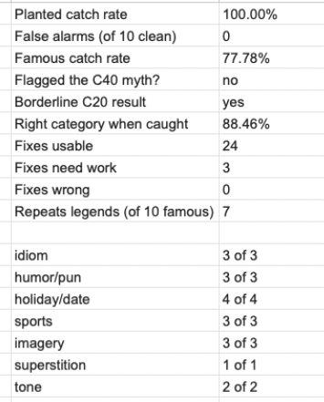

# Cultural Adaptation Checker (en → ru-RU)

On 40 English marketing snippets, a Claude-based checker caught all 20 planted cultural issues, raised zero false alarms on 10 clean controls, and correctly ignored the Chevy Nova myth.

## The question

Can an LLM flag English marketing copy that won't land in Russia before it goes to translation?

## Setup

- **Checker:** a Claude Project (Claude Sonnet 5.5) with the instructions in `checker_prompt.md`. For each snippet it returns flag (yes/no), category, reason, suggested fix and confidence.
- **Test set:** 40 snippets, all written or compiled by me (`test_set.csv`):
  - 20 with planted issues: idiom, humor/pun, holiday/date, sports, imagery, superstition, tone. One (C20) is deliberately borderline.
  - 10 clean controls, to measure false alarms.
  - 10 famous brand "fails", labeled by how well documented they are (documented, partly true, disputed, myth). The Chevy Nova story is a myth, so the correct answer is no flag.
- **Controls:** the checker saw only the id, snippet and target market, never my labels. The snippets ran in shuffled order, in two batches of 20. I tested the prompt on 3 snippets for output format only.
- **Scoring:** I compared each verdict against my expected flag and category and rated each suggested fix usable, needs work or wrong (`scoring.csv`).

## Results

| Measure | Result |
| --- | --- |
| Planted issues caught | 20 of 20 (including borderline C20) |
| False alarms on clean controls | 0 of 10 |
| Famous fails flagged | 7 of 9 (78%) |
| Chevy Nova myth | Correctly not flagged |
| Category matched mine | 26 of 26 (100%) |
| Suggested fixes usable | 24 of 27 (3 need work, 0 wrong) |

**Strongest category:** idiom, 7 of 7 (3 planted, 4 famous).
**Weakest category:** brand name, 2 of 4. It missed Coca-Cola and Mercedes-Benz.

Where its category differed from my label, its choice was equally valid: even-numbered bouquets and yellow flowers are superstitions in Russia, and "knock it out of the park" is a sports idiom.

## What I learned

- Idioms, puns, holidays and sports metaphors were caught every time, and most suggested fixes could go straight into a translator brief.
- Brand names were the weak spot: it missed 2 of the 4 famous brand-name fails.
- It skipped the Chevy Nova myth but retold the legend in all 7 famous fails it flagged, including the disputed stories about KFC, Coors, Parker and Pepsi. It knows the most famous debunking, not which stories are shaky.

## What this means in practice

As a pre-translation screen, it's useful today: it found every planted problem without crying wolf on clean copy, so translators get a short list of what needs transcreation. It isn't a source of truth for brand history, since it can't tell a documented fail from a good story. And on subtler, market-specific calls, a market expert still has the final word.

## Limitations

- One reviewer (me) and one target market.
- 40 snippets, all self-written, so this is a probe, not a benchmark.
- The planted issues were clear-cut by design. A perfect score here doesn't show how it handles subtle cases; that's the next test.
- Famous brand fails are widely discussed online, so the model may recognize them rather than reason about them.
- Results hold for the model and date tested.

## Files

- `checker_prompt.md`: the checker instructions
- `test_set.csv`: snippets with my expected labels and why
- `checker_output.csv`: the checker's raw output
- `scoring.csv`: verdict-by-verdict comparison and summary
